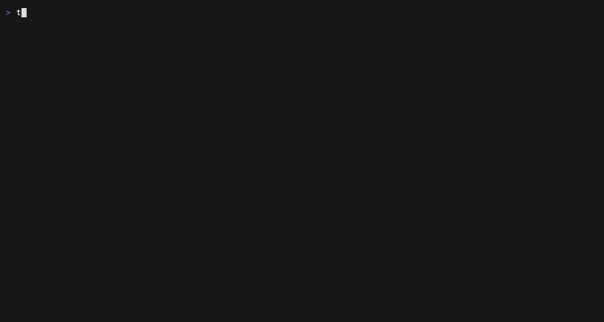

# tlschecker

Check the TLS certificates of every host you run, in one command: expiry,
revocation (OCSP and CRL), hostname and chain trust. Each host gets one status,
and the run one exit code your CI can gate on. A single binary for Linux, macOS
and Windows.

[](https://github.com/jbovet/tlschecker/actions/workflows/minimal.yml)
[](https://github.com/jbovet/tlschecker/releases/latest)
[](https://hub.docker.com/r/josebovet/tlschecker)
[](LICENSE)
<!-- crates.io badge: add once the crate is published (#21). -->



## Quick start

**1. Install** — one line per channel; every release archive has a `.sha256`
next to it on the [releases page](https://github.com/jbovet/tlschecker/releases).

```sh
# Homebrew (macOS, Linux) — also installs bash/zsh/fish completions
brew install jbovet/tap/tlschecker

# Linux / macOS binary: use linux-x86_64, linux-aarch64, macos-x86_64 or macos-aarch64
curl -fsSL https://github.com/jbovet/tlschecker/releases/latest/download/tlschecker-linux-x86_64.tar.gz | tar -xz && sudo install tlschecker /usr/local/bin/

# Docker (linux/amd64, linux/arm64)
docker run --rm josebovet/tlschecker example.com

# From source (needs a C compiler and perl: OpenSSL is built in)
cargo install --locked --git https://github.com/jbovet/tlschecker
```

```powershell
# Windows (x86_64, PowerShell): unpacks tlschecker.exe into the current directory
Invoke-WebRequest https://github.com/jbovet/tlschecker/releases/latest/download/tlschecker-windows-x86_64.zip -OutFile tlschecker.zip; Expand-Archive tlschecker.zip .
```

**2. Check your hosts.** `tlschecker example.com` opens the dashboard above in
a terminal. Piped, or with `--no-dashboard`, it prints a summary, the findings
behind each status, and why the run failed:

```console
$ tlschecker --no-dashboard shop.example.com api.example.com legacy.example.com old.example.com
┌────────────────────┬───────────┬─────────────┬──────────┬─────────────┬──────────┐
│ Host               ┆ Days left ┆ Issuer      ┆ Protocol ┆ Revocation  ┆ Status   │
╞════════════════════╪═══════════╪═════════════╪══════════╪═════════════╪══════════╡
│ shop.example.com   ┆     62    ┆ Example CA  ┆ TLSv1.3  ┆ Not checked ┆  Healthy │
├╌╌╌╌╌╌╌╌╌╌╌╌╌╌╌╌╌╌╌╌┼╌╌╌╌╌╌╌╌╌╌╌┼╌╌╌╌╌╌╌╌╌╌╌╌╌┼╌╌╌╌╌╌╌╌╌╌┼╌╌╌╌╌╌╌╌╌╌╌╌╌┼╌╌╌╌╌╌╌╌╌╌┤
│ api.example.com    ┆     8     ┆ Example CA  ┆ TLSv1.3  ┆ Not checked ┆ Critical │
├╌╌╌╌╌╌╌╌╌╌╌╌╌╌╌╌╌╌╌╌┼╌╌╌╌╌╌╌╌╌╌╌┼╌╌╌╌╌╌╌╌╌╌╌╌╌┼╌╌╌╌╌╌╌╌╌╌┼╌╌╌╌╌╌╌╌╌╌╌╌╌┼╌╌╌╌╌╌╌╌╌╌┤
│ legacy.example.com ┆    264    ┆ Internal CA ┆ TLSv1.3  ┆ Not checked ┆  Warning │
├╌╌╌╌╌╌╌╌╌╌╌╌╌╌╌╌╌╌╌╌┼╌╌╌╌╌╌╌╌╌╌╌┼╌╌╌╌╌╌╌╌╌╌╌╌╌┼╌╌╌╌╌╌╌╌╌╌┼╌╌╌╌╌╌╌╌╌╌╌╌╌┼╌╌╌╌╌╌╌╌╌╌┤
│ old.example.com    ┆     -5    ┆ Example CA  ┆ TLSv1.3  ┆ Not checked ┆ Critical │
└────────────────────┴───────────┴─────────────┴──────────┴─────────────┴──────────┘

Findings:

  Host: api.example.com (Critical)
    [critical] EXPIRES SOON: 8 days left (below 15 days)

  Host: legacy.example.com (Warning)
    [warning] UNTRUSTED: Certificate chain is not trusted: unable to get local issuer certificate

  Host: old.example.com (Critical)
    [critical] EXPIRED: Certificate expired on Oct 11 12:39:02 2026 GMT
    [warning] UNTRUSTED: Certificate chain is not trusted: certificate has expired
error: api.example.com: Critical - EXPIRES SOON: 8 days left (below 15 days)
error: old.example.com: Critical - EXPIRED: Certificate expired on Oct 11 12:39:02 2026 GMT
error: 4 host(s): 2 critical, 1 warning, 1 healthy, 0 not checked -> exit 1 (certificate problem at --fail-on critical; report only: --fail-on never; accept one finding: --allow <finding>)
```

Add `--check-revocation` to ask each CA over OCSP (CRL as the fallback),
`--hosts-file hosts.txt` or `-` (stdin) for long lists, and `--grade`, `--scan`
or `--ct-check` for more (see [How to use](#how-to-use)).

**3. Script it.** `-o json` prints one versioned document, every host included
— see [JSON output](#json-output):

```console
$ tlschecker -o json --fail-on never shop.example.com api.example.com legacy.example.com old.example.com \
    | jq -c '.results[] | {target, verdict: .status.verdict, days: .certificate.days_remaining}'
{"target":"shop.example.com","verdict":"healthy","days":62}
{"target":"api.example.com","verdict":"critical","days":8}
{"target":"legacy.example.com","verdict":"warning","days":264}
{"target":"old.example.com","verdict":"critical","days":-5}
```

**4. Gate CI.** The exit code is the answer: `0` all good, `1` a certificate
problem (Critical by default, `--fail-on warning` for stricter), `2` a usage
error, `3` a host that could not be checked — see
[Status & exit codes](#status--exit-codes). A daily check in GitHub Actions:

```yaml
on:
  schedule: [{ cron: "0 6 * * *" }]
jobs:
  certificates:
    runs-on: ubuntu-latest
    steps:
      - uses: actions/checkout@v7
      - run: curl -fsSL https://github.com/jbovet/tlschecker/releases/latest/download/tlschecker-linux-x86_64.tar.gz | tar -xz
      - run: ./tlschecker --check-revocation --hosts-file hosts.txt
```

## Docker

The published image [`josebovet/tlschecker`](https://hub.docker.com/r/josebovet/tlschecker)
runs natively on amd64 and arm64 (Apple Silicon included):

```sh
docker run --rm josebovet/tlschecker example.com        # summary table
docker run --rm -it josebovet/tlschecker example.com    # interactive dashboard
```

The dashboard needs a terminal, so it only opens with `-it`; without it the
container prints the summary, as in pipelines and CI. To build the image
yourself: `docker build -t tlschecker:local .`

## How to use

`tlschecker --help` lists every flag, with the exit codes at the end.

Hosts can be given as arguments, read from a file, or piped in — one or more
per line, with blank lines and `#` comments ignored:

```sh
➜ tlschecker example.com api.example.com:8443
➜ tlschecker --hosts-file hosts.txt
➜ kubectl get ingress -A -o jsonpath='{..host}' | tlschecker -
```

The summary table (the non-interactive default) shows `Host | Days left |
Issuer | Protocol | Revocation | Status` (plus `Grade` / `CT` when they ran);
`--wide` adds the hours left and the cipher suite. `-o text` and `-o json`
(also `--output`) carry every field.

Shell completions: `tlschecker --completions bash|zsh|fish|elvish|powershell`,
e.g. `tlschecker --completions zsh > ~/.zfunc/_tlschecker`.

### Interactive dashboard

When run in an interactive terminal, tlschecker opens a live dashboard by
default. Hosts stream in as they are checked:

```sh
➜ tlschecker jpbd.dev expired.badssl.com google.com cloudflare.com
```


**Fleet list.** Every host with its verdict and grade:

- `✓` healthy · `⚠` warning · `✗` critical — the same status the summary
  table, JSON, Prometheus and the exit code report (see
  [*Status & exit codes*](#status--exit-codes)). A host that could not be
  checked shows why, e.g. `✗ host (DNS)`.
- A yellow `?` after the grade means a revocation or CT check you asked for
  could not reach a verdict (see *Not verified* below). It does not change the
  verdict: an unreachable OCSP responder or a crt.sh outage says nothing bad
  about the certificate.

The **Tally** below counts hosts per verdict, failed checks, and hosts with
unverified checks.

**Detail pane.** For the selected host:

- **Facts** — negotiated protocol, cipher and ALPN; issuer; key; `Revocation`
  (`Not revoked`, `Revoked (via CRL)`, `Unknown`, `Not checked`); `CT`
  (`Logged · <crt.sh link>`, `Not logged`, `Unknown` — shown once CT was
  checked); chain `Trust`; SHA-256 fingerprint.
- **Expiry gauge** — how much of the certificate's lifetime has elapsed.
- **Grade** with a gauge per category.
- **Not verified** — why a requested revocation or CT check came back
  `Unknown`, e.g. `OCSP: http://ocsp.example: response signature verification
  failed; CRL: certificate lists no CRL distribution point`.
- **Warnings** — every security warning for the host, marked by severity
  (`✗` critical, `⚠` warning, `·` info) and `(allowed)` when accepted with
  `--allow`.

**Certificate explorer.** Press `Enter` on a host for the full report: subject
and issuer, validity, **Trust & Revocation** (self-signed, trust, revocation
and CT, with each failed OCSP responder / CRL distribution point on its own
`↳` line), certificate details (serial, fingerprints, key identifiers,
validation level, key usage, basic constraints), issuer and revocation URLs,
connection, SANs, embedded SCTs, the presented chain, the grade breakdown with
reasons, and scan results when `--scan` was used.


**Checks on demand.** Revocation and CT lookups are opt-in on the command line
because they cost network round trips — but you can run them from the
dashboard at any time for the selected host: `r` checks revocation (OCSP, then
CRL, against the chain already retrieved — no new TLS connection) and `c` looks
the certificate up in Certificate Transparency. The footer offers each one only
while the host has no definitive answer yet (never checked, or `Unknown`, so a
failed check can be retried). The pane shows `checking…` meanwhile; the verdict
and grade update when the result arrives, and a revocation found this way
counts toward the exit status.

**Keys:**

| Key | Fleet list | Explorer |
|---|---|---|
| `j` / `k`, arrows | move | scroll |
| `PgUp` / `PgDn`, `Space` | — | page |
| `g` / `G` | first / last host | top / bottom |
| `Enter` | open the explorer | back |
| `Esc`, `Backspace` | `Esc` quits | back |
| `r` / `c` | check revocation / CT for the selected host | same |
| `e` | export the chain as PEM | same |
| `q`, `Ctrl+C` | quit | quit |

Press `e` on either screen to export the selected host's certificate chain as
PEM. The prompt is prefilled with a filename derived from the host (so
`https://example.com:8443` becomes `example.com.pem`); edit it as you like and
press `Enter` to write, or `Esc` to cancel (`Ctrl+U` clears the field, `Ctrl+W`
drops a path segment). An existing file is never
overwritten: the prompt stays open with the reason shown beneath the path, so
you can adjust the name and retry without retyping it. This is the interactive
equivalent of `--export-pem`.

The TUI requires an attached terminal. In Docker, that means using `-it` so the
container gets a pseudo-TTY and stdin. Without that, Docker will fall back to
the classic text output. The classic text outputs are also used automatically
whenever stdout is piped or redirected, and can always be forced with
`-o summary|json|text` or `--no-dashboard` (keeps the configured/`-o`
format) — so scripts, CI pipelines, and `tlschecker -o json | jq` behave
exactly as before.

### Status & exit codes

Every host gets one status — **Healthy**, **Warning** or **Critical** — computed
by a single function (`tlschecker::verdict::assess`). The summary table's
Status column, the text `Status:` line, the JSON `status` object, the dashboard,
the `tlschecker_verdict` Prometheus gauge and the exit code all read it, so
they always agree.

- **Critical** — every validating client rejects the certificate now or very
  soon, whatever trust store it uses.
- **Warning** — the outcome depends on the client or its trust store, or
  security is weakened. Private CAs are legitimate, so untrusted and
  self-signed certificates are Warning, not Critical.
- **Info** — reported, never affects the status.

The status is the highest severity among the host's findings (Healthy when
there are none):

| Finding | Code (`--allow`) | Severity | Label | Allowable |
|---|---|---|---|---|
| Certificate expired | `expired` | Critical | `EXPIRED` | no |
| Certificate revoked (OCSP/CRL) | `revoked` | Critical | `REVOKED` | no |
| Inside the critical expiry window | `expires-soon` | Critical | `EXPIRES SOON` | no |
| Inside the warning expiry window | `expires-soon` | Warning | `EXPIRES SOON` | no |
| Not valid for the checked name | `hostname-mismatch` | Critical | `HOSTNAME MISMATCH` | yes |
| Self-signed certificate | `self-signed` | Warning | `SELF-SIGNED` | yes |
| Chain does not build to a system root | `untrusted` | Warning | `UNTRUSTED` | yes |
| Chain link not signed by its issuer | `invalid-chain-signature` | Warning | `INVALID CHAIN SIGNATURE` | yes |
| Issuer missing from the chain | `incomplete-chain` | Warning | `INCOMPLETE CHAIN` | yes |
| Chain not in issuer order | `invalid-chain-order` | Warning | `INVALID CHAIN ORDER` | yes |
| SHA-1 / MD5 signature | `weak-signature` | Warning | `WEAK ALGORITHM` | yes |
| Intermediate expired or expiring | `expiring-intermediate` | Warning | `EXPIRING INTERMEDIATE` | yes |
| Obsolete protocol negotiated, or supported (`--scan`) | `weak-protocol` | Warning | `WEAK PROTOCOL` | yes |
| Weak cipher negotiated, or accepted (`--scan`) | `weak-cipher` | Warning | `WEAK CIPHER` | yes |
| Issuance best-practice violation | `misissuance` | Warning | `MISISSUANCE` | yes |
| Not in public CT logs (`--ct-check`) | `not-in-ct` | Info | `NOT IN CT LOG` | yes |

**Never a finding**, at any level: a revocation or CT check that came back
`Unknown` (or was not requested), trust `Unknown` (no system CA bundle), and the
grade. An unreachable OCSP responder or a crt.sh outage says nothing bad about
the certificate, and the grade measures configuration quality, not validity.

**Expiry windows** are "fewer than N" everywhere:

- Certificates with a lifetime of 90 days or more (Let's Encrypt's 90-day
  certificates included): Critical below 15 days left, Warning below 30.
- Shorter-lived certificates scale with their lifetime — Critical in its last
  sixth, Warning in its last third — with no step at 90 days:

  | Lifetime | Critical | Warning |
  |---|---|---|
  | ≥ 90 days | < 15 days | < 30 days |
  | 47 days | < 188 hours | < 376 hours |
  | 6 days | < 24 hours | < 48 hours |
  | 24 hours | < 4 hours | < 8 hours |

- `--min-validity N` (or `min_validity = N`) replaces the critical window with
  your own threshold: fewer than N days left is Critical. `0` leaves only
  expired certificates Critical. The warning window still applies.

**Exit codes:**

| Code | Name | When |
|---|---|---|
| 0 | OK | No checked host is at or above the `--fail-on` level, and every host was checked. With `--allow-unreachable`, unreachable hosts are tolerated as long as at least one host was checked. Also returned by `--help`, `--version`, `--generate-config`, and a dashboard quit while hosts were still pending (pending hosts are never errors). |
| 1 | Certificate problem | A checked host's status is at or above `--fail-on` (default `critical`). |
| 2 | Usage / config | Nothing was checked: invalid flags or values, a missing or unparsable config file, no hosts, a negative `min_validity`, a legacy `exit_code` other than 0 or 1, or `--connect-timeout` / `--concurrency` out of range. |
| 3 | Host(s) not checked | A host failed: DNS, connection, handshake, certificate retrieval, an internal error while checking it, or an invalid address. Unreachable hosts are exempt under `--allow-unreachable` when at least one host was checked; invalid addresses never are (they are a host-list typo, not a flaky network). |
| 4 | Internal | The run failed after it started, e.g. a dashboard terminal error. |

Precedence is 2 > 4 > 1 > 3 > 0: a definitive certificate problem is never
hidden behind a flaky-network code. The two controls are independent —
`--fail-on` decides only exit 1, `--allow-unreachable` only exit 3 — and a run
where hosts were attempted but none could be checked never exits 0. Every
non-zero exit is explained on stderr (stdout stays clean for `| jq`): the
findings that caused it, the counts, and the flag that changes the outcome.

**Controls:**

- `--fail-on critical|warning|never` (config `fail_on`) — the status that fails
  the run. `never` reports only; hosts that could not be checked still exit 3.
- `--allow <finding>` — accept one finding (comma-separated or repeated). It is
  still reported, marked `allowed`, but no longer affects the status or the exit
  code. `expired`, `revoked` and `expires-soon` cannot be allowed: use
  `--fail-on never` to report them without failing, or `--min-validity` to tune
  the window.
- `--allow-unreachable` — do not exit 3 for hosts that cannot be reached, as
  long as at least one host was checked.

Recipes:

```sh
# CI gate (the default): fail on expired, revoked, wrong-name or expiring certs
tlschecker -o json example.com api.example.com

# Strict: also fail on self-signed, untrusted, chain defects, < 30 days left
tlschecker --fail-on warning example.com

# Report only (monitoring cron, Prometheus): never exit 1, ignore down hosts
tlschecker --fail-on never --allow-unreachable --prometheus example.com

# Private CA: trust your CA explicitly, or accept the finding
SSL_CERT_FILE=/etc/ssl/bundle-with-my-ca.pem tlschecker internal.example.com
tlschecker --allow untrusted internal.example.com
```

The severity table is part of the public contract: raising a severity, or
adding a Critical finding, is a breaking change; lowering a severity, or adding
a Warning or Info finding, is a minor change.

### JSON output

`-o json` prints one document with a schema version and one entry per host,
in input order — including hosts that could not be checked:

```json
{
  "schema_version": 1,
  "results": [
    {
      "input": "example.com:8443",
      "target": "example.com:8443",
      "host": "example.com",
      "port": 8443,
      "outcome": "checked",
      "error": null,
      "status": { "verdict": "warning", "findings": [
        { "code": "untrusted", "severity": "warning", "allowed": false,
          "message": "Certificate chain is not trusted: self-signed certificate" } ] },
      "connection": { "protocol": "TLSv1.3", "cipher": "TLS_AES_256_GCM_SHA384",
                      "cipher_bits": 256, "alpn": null },
      "certificate": {
        "subject": { "common_name": "example.com", "organization": null, "...": "..." },
        "issuer": { "common_name": "Example CA", "organization": null, "country": null },
        "not_before": "2026-10-15T19:19:49Z", "not_after": "2027-05-03T19:19:49Z",
        "not_before_unix": 1792091989, "not_after_unix": 1809371989,
        "days_remaining": 199, "hours_remaining": 4794, "expired": false,
        "serial": "0B:C9:…", "version": 3, "signature_algorithm": "sha256WithRSAEncryption",
        "key": { "algorithm": "RSA", "bits": 2048 },
        "fingerprints": { "sha256": "FB:F0:…", "sha1": "2F:97:…" },
        "sans": ["example.com"],
        "trust": { "status": "untrusted", "reason": "self-signed certificate" },
        "revocation": { "status": "not_checked", "reason": null, "detail": null },
        "urls": { "ocsp": [], "ca_issuers": [], "crl": [] },
        "chain": [ { "subject": "example.com", "issuer": "Example CA",
                     "not_before": "…", "not_after": "…", "…": "…" } ],
        "…": "…"
      },
      "grade": null,
      "scan": null,
      "ct": null
    },
    {
      "input": "down.example.com",
      "target": "down.example.com",
      "host": "down.example.com",
      "port": 443,
      "outcome": "error",
      "error": { "kind": "dns", "message": "failed to lookup address information: …",
                 "hint": "DNS lookup failed: the host name does not resolve" },
      "status": null, "connection": null, "certificate": null,
      "grade": null, "scan": null, "ct": null
    }
  ]
}
```

- **Every key is always present.** A value that does not apply is `null`, never
  the string `"None"`; `grade`, `scan` and `ct` are `null` unless `--grade`,
  `--scan` or `--ct-check` produced them.
- **`outcome`** is `checked` or `error`. An error entry carries
  `error.kind` (`dns`, `connection`, `handshake`, `certificate`, `invalid`,
  `internal` or `error`), the raw `message`, and a plain-language `hint` for
  common errors (`null` otherwise); an invalid address has `null` `host`, `port`
  and `target`.
- **`target`** is how every output names the host: `host` on 443, `host:port`
  otherwise. `input` is exactly what you typed.
- **`status`** is the same verdict and findings the summary, dashboard,
  Prometheus and exit code use (see *Status & exit codes*).
- **Timestamps** are RFC 3339 UTC strings with the Unix seconds alongside;
  `chain` lists every certificate the server presented, leaf first.
- **Stability:** from `schema_version` 1 on, changes are additive (new keys).
  Renaming, removing or retyping a key bumps the version.

```sh
# Hosts whose certificate expires within 30 days
tlschecker -o json --fail-on never --hosts-file hosts.txt \
  | jq -r '.results[] | select(.certificate.days_remaining < 30) | .target'

# Hosts that could not be checked, with the reason
tlschecker -o json --fail-on never --allow-unreachable --hosts-file hosts.txt \
  | jq -r '.results[] | select(.outcome == "error") | "\(.input): \(.error.message)"'
```

### Versioning

tlschecker follows [semantic versioning](https://semver.org) for its command
line: flags, exit codes, the severity table and the JSON schema change
incompatibly only in a major version. The Rust library API is not covered yet:
it may still change in 3.x minor releases until the crate is published on
crates.io.

## Examples

Using custom ports:
```sh
➜ tlschecker example.com:8443 secure-service.internal:9443
```

You can specify the port in three ways:
1. Using hostname:port format: `example.com:8443`
2. Using a full URL: `https://example.com:8443`
3. Using the default port (443) by just specifying the hostname: `example.com`

### Trust Validation

TLSChecker verifies that the presented certificate chain builds to a trusted root in your operating system's trust store — the same authoritative check a browser performs. This runs automatically for every host (it is offline and adds no latency) and is reported as a `Trust:` line and, in JSON, as `certificate.trust` (`status` + `reason`):

- **Trusted**: the chain builds to a system root CA
- **Untrusted (reason)**: the chain does not verify — the reason is the underlying error, e.g. `self-signed certificate`, `unable to get local issuer certificate`, or `certificate has expired`
- **Unknown**: no system trust store was available, so trust could not be determined (never reported as a problem)

An untrusted chain adds an `UNTRUSTED` finding (Warning: shown everywhere, fails the run only with `--fail-on warning`) and caps the configuration grade at C. Because verification happens *after* inspection, expired and self-signed certificates are still fully reported rather than rejected at the handshake.

To make hosts behind a private CA read as Trusted, point `SSL_CERT_FILE` at a bundle that contains the system roots plus your CA (it replaces the system bundle, so include both).

### Certificate Metadata

Every check also reports (offline, no extra flags) a set of certificate and
connection details:

- **ALPN** — the negotiated application protocol (`h2` / `http/1.1`).
- **Subject / Authority Key ID** — the SKI/AKI identifiers.
- **Validation Level** — `DV` / `OV` / `EV` / `IV`, derived from the CA/Browser-Forum policy OIDs.
- **Key Usage / Extended Key Usage / Basic Constraints** — what the certificate is authorized for.

It also raises `MISISSUANCE` warnings (Warning severity; they do *not* affect
the grade, so legitimate private/internal certificates are never penalized)
for issuance problems: a leaf asserting `CA:TRUE`, a missing `serverAuth` EKU, a
low-entropy serial, or an over-long (> 398-day) validity period. A chain link
whose signature does not cryptographically verify is reported separately as
`INVALID CHAIN SIGNATURE` and caps the grade at C.

### Certificate Revocation Checking

TLSChecker supports comprehensive certificate revocation checking via both OCSP (Online Certificate Status Protocol) and CRL (Certificate Revocation List). These features allow you to verify if a certificate has been revoked by its issuing Certificate Authority.

To enable revocation checking, use the `--check-revocation` flag:

```sh
➜ tlschecker --check-revocation jpbd.dev
```

#### How Revocation Checking Works

When you enable revocation checking, TLSChecker will:

1. First check certificate status via OCSP, which provides real-time revocation information
2. If OCSP doesn't provide a definitive answer, fall back to CRL checking
3. Report the certificate as revoked if either method indicates revocation

The revocation status is shown the same way in every output (summary, text, and the dashboard):
- **Not revoked**: confirmed by OCSP or CRL
- **Revoked**: the certificate has been revoked, with how or when when available, e.g. `Revoked (via CRL)`
- **Unknown**: the status could not be determined. The reason — each OCSP responder and CRL distribution point that failed — is shown in `text` output, in JSON as `certificate.revocation.detail`, and in the dashboard's *Not verified* block
- **Not checked**: revocation was not requested (the default without the flag; in the dashboard, press `r` to check the selected host)

Example with a revoked certificate:
```sh
➜ tlschecker --check-revocation revoked.badssl.com
```

#### Revocation Checking Methods

**OCSP (Online Certificate Status Protocol)**:
- Real-time check with the certificate authority
- Faster and more up-to-date than CRLs
- May not be supported by all certificate authorities

**CRL (Certificate Revocation List)**:
- Downloads and checks the CA's published list of revoked certificates
- More widely supported than OCSP
- Lists may be larger and less frequently updated

Note: Revocation checking requires network connections to OCSP responders and CRL distribution points, which adds some latency to the checks.

#### Prometheus Integration with Revocation Metrics

When using Prometheus integration, the revocation status is included in the metrics:

```sh
tlschecker --prometheus --prometheus-address http://localhost:9091 --check-revocation example.com
```

A `tlschecker_revocation_status` metric is exported with the following values:

- 0 = Not checked
- 1 = Good (not revoked)
- 2 = Unknown
- 3 = Revoked

##### Metric labels and the push grouping key

Every pushed series carries only stable identity labels in the push **grouping key**: `job="tlschecker"` and `instance="<host>"` (`"<host>:<port>"` when the port is not 443, so two ports of one host never overwrite each other). This is deliberate — a `push_metrics` `PUT` replaces the series under its exact grouping key, so putting volatile values (grade, cipher, expired, …) in the key would leave the previous run's series orphaned in the gateway whenever one of those values changed.

Each host also gets `tlschecker_verdict` — its status as `0` healthy, `1` warning, `2` critical, by the same rules as the CLI status and exit code (including `--min-validity` and `--allow`). Alert on it to page on exactly what would fail a CI run:

```promql
tlschecker_verdict{job="tlschecker"} == 2
```

`tlschecker_below_min_validity` is unchanged: it is driven only by an explicit `--min-validity` and is `0` when that is unset.

Descriptive, changeable metadata therefore lives on a dedicated info metric, `tlschecker_certificate_info` (constant value `1`), with labels `cipher`, `cipher_protocol_version`, `issuer`, and `grade` (`N/A` when grading did not run). Join it to the numeric metrics on `instance` in your queries, e.g.:

```promql
tlschecker_days_before_expired * on(instance) group_left(grade, issuer) tlschecker_certificate_info
```

### Connection Timeout

Each host gets 30 seconds to connect by default. Use `--connect-timeout` to change that budget (1–3600 seconds):

```sh
➜ tlschecker --connect-timeout 5 example.com internal.example.com
```

The value is the budget for the **connect phase of one host** — shared across every address the hostname resolves to — and is also applied as the socket read timeout during the handshake. Because each check occupies a worker thread, lowering it keeps a large host list moving when some hosts are unreachable; raise it for slow links.

It is deliberately named for what it bounds: it does **not** cap the whole check. `--check-revocation` (OCSP and each CRL distribution point) and `--ct-check` keep their own separate timeouts, and `--scan` caps its per-handshake wait at 10 seconds regardless of this setting, since a scan performs on the order of a hundred connections. Note that lowering the timeout can make `--scan` report a protocol as unsupported when the probe merely timed out.

### Concurrency

Hosts are checked 32 at a time by default. Use `--concurrency` to change that (1–128):

```sh
➜ tlschecker --concurrency 64 --hosts-file hosts.txt
```

A check spends its time waiting on the network, not the CPU, so the default does not depend on the machine's cores: a container limited to a single CPU checks as many hosts at once as a large server. Raise it for large host lists; lower it to go easy on a shared network or on many hosts behind a single address.

With `--check-revocation`, hosts whose certificates name the same CRL distribution point share one download of it, and a download is refused above 32 MiB (256 KiB for an OCSP response), so checking many hosts at once does not multiply memory use.

Hostnames that resolve to several addresses (an A and a AAAA record, or a pool of load-balanced servers) are tried **in resolution order until one accepts**, so a host that is up on one of its addresses is not reported as unreachable just because the first address it resolves to is not. This matters most on IPv4-only networks whose resolver still returns AAAA records.

### Certificate Fingerprints

Every check reports the SHA-256 and SHA-1 fingerprints of the leaf certificate (colon-separated uppercase hex, the same format as browsers and `openssl x509 -fingerprint`). They appear in `text` and `json` output and are useful for certificate pinning and comparison.

### Exporting the Certificate Chain (PEM)

Use `--export-pem` to print the presented certificate chain (leaf first, followed by any intermediates the server sent) as PEM instead of the normal report:

```sh
➜ tlschecker --export-pem example.com > example.pem
```

This works for multiple hosts too; each host's chain is printed in sequence.

### TLS Protocol & Cipher Scanning

By default tlschecker reports only the protocol and cipher that were negotiated for a single connection. With `--scan` it actively probes the server to enumerate **every** TLS protocol version (SSLv3 through TLS 1.3) and the cipher suites accepted at each version:

```sh
➜ tlschecker --scan example.com
```

Because this performs many short handshakes (one per version/cipher), it is slower than a normal check. Results are included in `text` and `json` output.

`--scan` implies `--grade` (the scan is surfaced through the grade, including in the summary table). Scan results feed the analysis: supporting an obsolete/deprecated protocol or accepting a weak cipher produces security warnings (see below) and lowers the grade. This makes the grade reflect the server's *full* posture rather than only the single negotiated connection (e.g. a server that negotiates TLS 1.3 but still allows TLS 1.0 will no longer score an A).

### Embedded SCTs (offline Certificate Transparency)

Every check also reads the leaf's **embedded Signed Certificate Timestamps** (SCTs) — the signed promises a CA receives when it submits a certificate to Certificate Transparency logs (RFC 6962). Their presence is offline proof that the certificate was submitted to CT, and unlike the `--ct-check` lookup below it needs **no network** and is always on:

```sh
➜ tlschecker -o text example.com
...
Embedded SCTs (Certificate Transparency): 2
  - log cb38f715897c84a1445f5bc1ddfbc96ef29a59cd470a690585b0cb14c31458e7 at 2026-05-18T19:35:22Z
  - log d809553b944f7affc816196f944f85abb0f8fc5e8755260f15d12e72bb454b14 at 2026-05-18T19:35:22Z
```

SCTs appear in `text` and `json` output only when present. They complement `--ct-check`: the lookup confirms *inclusion* against crt.sh, while embedded SCTs prove *submission* and stay available even when crt.sh is unreachable — so a `--ct-check` result of `Unknown` will note any embedded SCTs as offline evidence.

### Certificate Transparency Lookup

Modern browsers reject publicly-trusted certificates that are not logged in [Certificate Transparency](https://certificate.transparency.dev/) logs, and the same logs are what defenders watch for mis-issuance. With `--ct-check`, tlschecker looks the presented leaf up in public CT logs via [crt.sh](https://crt.sh), matched by its SHA-256 fingerprint (an exact, per-certificate lookup):

```sh
➜ tlschecker --ct-check example.com
```

This performs a network request to an external service (crt.sh), so it is opt-in and adds latency. The result is **tri-state**, like revocation status:

- **Logged** — the exact certificate was found in CT. The `text`/`json` output include a direct `crt.sh` link; the summary table shows `✓`.
- **Not logged** — crt.sh has no record of the certificate *and* it carries no embedded SCTs, so absence from CT is plausible. Reported as an informational `NOT IN CT LOG` finding (see below) and shown as `✗` in the summary. A publicly-trusted certificate that is not logged will be rejected by modern browsers.
- **Unknown** — crt.sh was unreachable or rate-limited, or it has no record of a certificate that carries embedded SCTs (crt.sh is an aggregator and misses some certificates the logs do include), so the status could not be determined (`?` in the summary). This is kept distinct from "not logged" so an outage is never mistaken for a problem. The reason — together with any embedded-SCT evidence — is logged to **stderr** (stdout stays clean for `… -o json | jq`), kept in JSON as `ct.detail`, and shown in `text` output and the dashboard.

When `--ct-check` is used, the summary table gains a `CT` column (`✓`/`✗`/`?`); without it the column is hidden. Being absent from CT does **not** affect the status or the grade — many legitimate internal/private certificates are intentionally absent from public CT logs, so what that means is left to you rather than the grade.

### Security Warnings

In addition to revocation and grading, tlschecker surfaces certificate problems as security warnings in all output formats. Each is a finding with a severity (see [*Status & exit codes*](#status--exit-codes)):

- **Hostname mismatch** (Critical) — the certificate is not valid for the hostname you checked (no matching SAN, with wildcard support, or Common Name)
- **Untrusted** (Warning) — the chain does not build to a system root (see *Trust Validation*)
- **Weak signature algorithm** (Warning) — the certificate or a chain certificate is signed with SHA-1 or MD5
- **Incomplete chain** (Warning) — the certificate's issuer was not found in the presented chain
- **Invalid chain order** (Warning) — the chain is not in issuer order (each certificate should be followed by the one that issued it)
- **Invalid chain signature** (Warning) — a presented certificate is not validly signed by the issuer found for it in the chain (forged or corrupted certificate); caps the grade at C
- **Expiring intermediate** (Warning) — an intermediate certificate in the chain has expired or expires within 30 days
- **Weak protocol** (Warning) — the connection negotiated an obsolete (SSLv3) or deprecated (TLS 1.0/1.1) protocol version, or, with `--scan`, the server still supports one
- **Weak cipher** (Warning) — the connection negotiated a weak cipher suite (RC4, DES/3DES, NULL, EXPORT, anonymous, ...), or, with `--scan`, the server accepts one
- **Misissuance** (Warning) — the leaf deviates from issuance best practice (see *Certificate Metadata*)
- **Not in CT log** (Info, `--ct-check`) — the presented certificate was not found in any public Certificate Transparency log

A hostname mismatch, an untrusted chain, an invalid chain signature, support for an obsolete protocol (SSLv3, TLS 1.0 or TLS 1.1, which RFC 8996 deprecates), or acceptance of a weak cipher (scanned or negotiated) each cap the TLS grade at C, the same as a self-signed certificate. Negotiating one of those protocols caps it at D.

### Troubleshooting Connection Issues

A host that cannot be checked is reported on stderr as one line, with the
common errors explained in plain language:

```
error: example.com:8080: the port does not speak TLS (plain HTTP or another protocol?)
error: 10.0.0.5: connection refused (nothing is listening on that port)
error: typo.example: DNS lookup failed: the host name does not resolve
```

| Message | What to check |
|---|---|
| `DNS lookup failed` | Spelling of the hostname, your DNS configuration; try the IP address |
| `connection refused` | That a TLS service listens on that port; firewalls |
| `timed out` | Network path and firewalls; raise `--connect-timeout` for slow links |
| `the port does not speak TLS` | The port: e.g. `:80` is plain HTTP — use the TLS port |
| `no TLS version in common` / `rejected the TLS handshake` | The server only offers protocols or ciphers too old (or too new) for a handshake |
| `requires a client certificate` | The service uses mutual TLS |
| `does not recognize this hostname (SNI)` | The name you checked is not configured on that server |

Add `-v` to also see the raw error (OpenSSL's error stack or the OS error) and
informational messages, `-vv` for debug output, or `-q` to show errors only.
`RUST_LOG` (e.g. `RUST_LOG=debug` or `RUST_LOG=tlschecker=debug,reqwest=warn`)
overrides both. Colours are used only when stderr is a terminal and
[`NO_COLOR`](https://no-color.org) is not set. In JSON output, the same
explanation is `error.hint` next to the raw `error.message`.

### Configuration File Support

You can use a TOML configuration file to check multiple hosts. Create a file like `tlschecker.toml`:

```toml
hosts = [
    "example.com",
    "example.com:8443",
    "secure-service.internal:9443",
]

# Optional settings
output = "summary"
fail_on = "critical"   # or "warning", "never"
check_revocation = true
grade = false
min_validity = 30

[prometheus]
enabled = false
address = "http://localhost:9091"
```

You can also generate a commented example with `tlschecker --generate-config`.

Then run TLSChecker with the config file:

```sh
➜ tlschecker -c example-tlschecker.toml
```

See [tlschecker-example.toml](tlschecker-example.toml) for a complete configuration example.
